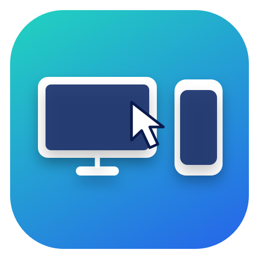

<p align="center"></p>

<h1 align="center">DeskBridge</h1>

<p align="center">
Use your Mac's mouse and keyboard on your Android phone or tablet.<br>
Push the pointer off the edge of the screen and it appears on the phone. Push it back and it returns.
</p>

<p align="center">
<a href="https://github.com/ThanhNg224/DeskBridge/releases/latest/download/DeskBridge.zip"><b>Download for Mac</b></a>
 ·
<a href="https://github.com/ThanhNg224/DeskBridge/releases/latest">All releases</a>
</p>

---

## Get started

You'll need an Apple Silicon Mac running macOS 14 or later, an Android phone or tablet running Android 13 or later, and a USB cable that supports data.

### 1. Install DeskBridge on your Mac

[**Download DeskBridge.zip**](https://github.com/ThanhNg224/DeskBridge/releases/latest/download/DeskBridge.zip), double-click the ZIP, then drag **DeskBridge** into **Applications**.

If you already use Homebrew, run this in Terminal instead:

```sh
brew install --cask thanhng224/deskbridge/deskbridge
```

Open DeskBridge from **Applications**. If macOS blocks the first launch because the app isn't notarized, follow [Apple's first-launch instructions](https://support.apple.com/en-us/102445#openanyway).

### 2. Follow the setup checklist on your Mac

1. Under **Accessibility access**, click **Open Settings** and turn on **DeskBridge** so it can use your mouse and keyboard to control the phone.
2. If **Android tools (adb)** is missing, click **Download from Google**, choose **SDK Platform-Tools for Mac**, then return to DeskBridge and click **Select ZIP…**. Choose the ZIP you just downloaded.

### 3. Connect your phone by USB

1. On your phone, open **Settings → About phone** and tap **Build number** seven times. On some phones, **Build number** is under **Software information**.
2. In **Settings**, search for **Developer options** and turn on **USB debugging**. On Xiaomi/HyperOS, also turn on **USB debugging (Security settings)** if available.
3. Plug the phone into your Mac, unlock it and tap **Allow** when asked to allow USB debugging. If multiple phones are connected, pick yours in DeskBridge.

When DeskBridge shows **Connected**, open **Controls**, choose the screen edge closest to your phone, then move the pointer past that edge. Press **Control + Option + Command + Esc** to bring it back to the Mac.

Once USB works, you can [switch to Wi-Fi](#questions).

## What it does

- **One mouse and keyboard for both.** Click, scroll, drag and type on the phone without touching it.
- **Over USB or Wi-Fi.** Plug in for low latency or connect wirelessly for convenience without cables. Nothing to install on the phone, no account needed.
- **Low transport latency.** USB PING/PONG round trips measured about 1 ms on the tested phone. Wi-Fi latency depends on your network; transport measurements do not include the full delay from moving the mouse to seeing the phone respond.
- **Copy and paste shortcuts just work.** `Cmd+C`, `Cmd+V` and `Cmd+A` become their Android equivalents, and copied text follows the pointer: copy on the Mac, paste on the phone, and the other way round.
- **Right click goes Back**, like on a phone (you can switch it to a real right click).
- **Type Vietnamese** with your Mac's input method (Telex, VNI): compose the word on the Mac, it appears on the phone when you press space.
- **Always a way out.** Press **⌃⌥⌘⎋** (Control+Option+Command+Esc) to get the pointer back on the Mac instantly.

## Keyboard shortcuts

These shortcuts work while the pointer is on the phone. Hold **Option (⌥)** and press the other key:

| Action on the phone | Shortcut |
| --- | --- |
| Home | `Option + H` |
| Back | `Option + B` |
| Recent apps | `Option + R` |
| Switch apps | `Option + Tab` |
| Turn off the screen | `Option + L` |
| Volume up / down | `Option + ↑` / `Option + ↓` |
| Brightness up / down | `Option + →` / `Option + ←` |
| Open or close notifications | `Option + N` |
| Mute / unmute | `Option + M` |
| Play / pause media | `Option + P` |

To switch apps, keep holding **Option**, press **Tab** until the app you want is selected, then release **Option**. The phone controls the appearance of the switcher. `Command + Tab` continues to switch Mac apps.

With **⌘ acts as Ctrl** enabled in DeskBridge settings, use `Command + C`, `Command + V` and `Command + A` on the phone to copy, paste and select all. Right-click also goes Back by default. To immediately return control to your Mac, press **Control + Option + Command + Esc**.

The phone's Android version and manufacturer determine how media, mute, brightness and the notification panel behave. Adjusting brightness may turn off automatic brightness. Turning off the screen does not necessarily require a PIN when you wake it; that depends on your phone's security settings.

## Questions

**The pointer does not cross.** Open DeskBridge: the checklist tells you which step is missing (Accessibility, `adb`, or the phone not authorized). Make sure the screen edge in Settings is the side where you move the mouse.

**Can I use it without a cable?** Yes. With the Mac and phone on the same Wi-Fi network, plug in via USB and enable **Automatically prepare Wi-Fi**. Select **Wi-Fi** when available, or unplug USB to let DeskBridge switch to the prepared connection. For an already configured phone, enter its IPv4 address and connection port in **Manual Wi-Fi**; the port must be between 1 and 65535. Android's Wireless Debugging connection port can differ from its pairing port. **Disconnect Wi-Fi** disconnects this Mac from that ADB endpoint; it does not turn off debugging on the phone.

**Which device is being controlled?** The header names the active phone and its USB or Wi-Fi connection. DeskBridge can fall back to another connection for the same phone. If neither connection is available, it keeps your phone selected. Use the phone picker to choose another device or the USB/Wi-Fi selector to change transport. A temporary Wi-Fi loss retries the selected IP and port automatically. **Disconnect Wi-Fi**, **Cancel**, and turning **Enabled** off stop automatic reconnection until you explicitly retry, select a connection, or enable control again. A Wi-Fi connection attempt has a 30-second limit; success means the control session is ready, not just that ADB accepted the connection.

**Is it safe?** Every DeskBridge session uses a one-time token. **Automatically prepare Wi-Fi** can enable legacy ADB TCP/IP, which does not encrypt traffic; use it only on a trusted network and turn off network debugging on the phone when finished. Android's paired Wireless Debugging uses TLS instead and requires pairing outside DeskBridge. The session token does not encrypt keyboard or clipboard data. Details in [the architecture notes](docs/ARCHITECTURE.md).

## Known limits

- **Typing with an input method** (Vietnamese Telex/VNI, ...): the word is composed on the Mac, where a small preview appears at the bottom of the screen, and goes to the phone when you commit it (space, punctuation). Words with accents reach the phone by pasting: the phone's clipboard is used for a moment and then put back (an image on the clipboard is lost), and Samsung may show its "Copied to clipboard" toast. Other input methods (Japanese, Chinese) are untested.
- **Clipboard:** text only (no images or files). It is shared when the pointer crosses, so something you copy by touching the phone while the pointer is on the Mac reaches the Mac the next time the pointer comes back from the phone. Samsung shows a "Copied to clipboard" toast when text arrives on the phone.
- **One phone at a time.** With several plugged in or connected, DeskBridge lets you choose which one.
- **Connection options:** USB avoids Wi-Fi interference. Wi-Fi provides cable-free use, with latency that depends on your local network.
- **Rotating the phone** while the pointer is on it takes effect the next time the pointer enters.
- **Locked phone:** the mouse wakes a sleeping screen but does not unlock it.
- **Bottom edge over the Dock:** the Mac pointer can flash for about a tenth of a second before it disappears, mostly when the DeskBridge window is on a second display. DeskBridge also comes to the front each time the pointer goes to the phone: it has to be the active app to hide the pointer.
- **Phones:** Android 13 and newer. Tested on a Samsung with Android 13, by hand on Android 10, and on Android 14, 15 and 16 emulators. Xiaomi/HyperOS and other vendor skins are untested.
- **Not notarized yet:** macOS asks you to approve the first launch (see *Get started*).

---

## For developers

The `main` branch is the macOS release line. The independent Windows 11 x64 app is developed on the [`windows` branch](https://github.com/ThanhNg224/DeskBridge/tree/windows). See the [Windows setup and acceptance guide](https://github.com/ThanhNg224/DeskBridge/blob/windows/windows/README.md).

DeskBridge is a Swift 6 menu bar app (`mac/`) plus a plain-Java server (`server/`) that the Mac starts on the phone through `adb shell app_process`. No APK, no Gradle, no Kotlin. Mouse and keyboard travel over an adb-forwarded abstract socket with a small binary protocol; the server injects them through Android's `InputManager` and draws its own pointer.

Start with **[docs/ARCHITECTURE.md](docs/ARCHITECTURE.md)** (decisions, protocol, security model, risks) and **[CLAUDE.md](CLAUDE.md)** (commands, rules and gotchas for people and AI agents).

### Build from source

Needs macOS 14+ on Apple Silicon, Xcode 16+ (Swift 6), JDK 17+, the Android SDK `build-tools` (`d8`) with any `platforms/android-*`, and `adb`.

```bash
scripts/setup_signing.sh   # once: a local signing identity, so macOS keeps the Accessibility grant across rebuilds
scripts/package_app.sh     # build/DeskBridge.app with the existing DeskBridge Dev identity
```

The package script signs and verifies a staged bundle before replacing the previous app. It stops if the local signing identity is missing or ambiguous; it does not silently fall back to ad-hoc signing. To choose another identity, set `CODESIGN_IDENTITY` explicitly. `scripts/release.sh` uses a separate `build/release/DeskBridge.app` and explicitly selects its release signing mode, leaving the developer app intact.

### Test

```bash
scripts/check.sh                                                     # everything: lint, server tests, builds, Mac tests
scripts/test_server.sh                                               # server unit tests (pure Java)
cd mac && swift test                                                 # Mac unit tests
scripts/run_on_device.sh com.deskbridge.server.PointerSpike          # injection diagnostic, look at the phone
cd mac && DESKBRIDGE_DEVICE=1 swift test --filter DeviceSmokeTests   # end to end on a plugged-in phone
scripts/device_matrix.sh                                             # Android 14, 15, 16 emulators
```

For Wi-Fi troubleshooting, Settings shows selectable ADB error details. To inspect operation IDs and stages in macOS unified logs, run:

```bash
log show --last 1h --info --predicate 'subsystem == "com.deskbridge.app" AND category == "wireless"'
```

ADB output and device addresses in logs are private; review details in Settings before sharing them.

### Release

`scripts/release.sh` builds `build/DeskBridge.zip`, the file behind the download link (`gh release upload vX.Y.Z build/DeskBridge.zip --clobber`). With a paid Apple Developer account it also signs, notarizes and staples, so users can skip the "Open Anyway" step:

```bash
DEVELOPER_ID="Developer ID Application: Name (TEAMID)" NOTARY_PROFILE=deskbridge scripts/release.sh
```

After publishing the ZIP, update the version and SHA-256 in the [Homebrew cask](https://github.com/ThanhNg224/homebrew-deskbridge/blob/main/Casks/deskbridge.rb).

(The one-time `notarytool store-credentials` step is described at the top of the script.)

### Verified on

Android 13 (Samsung, real device), Android 10 (by hand), Android 14, 15 and 16 (emulators). Other phones and vendor skins are untested; reports are welcome.
