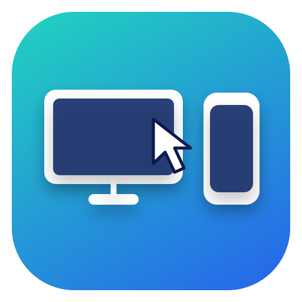

<p align="center"></p>

# DeskBridge

> Low-latency mouse & keyboard sharing between **macOS (Apple Silicon)** and **Android** over USB.

A spiritual successor to DeskDock built with modern tooling:
- **No APK on Android**: a plain-Java server runs through ADB `app_process` (shell UID).
- **Real mouse events**: hover, click, drag and scroll injected through Android's `InputManager`, with a pointer drawn by the server itself (injected events do not move Android's system pointer; verified on a device).
- **Sub-millisecond transport**: adb USB round trip measured p50 0.74 ms / p95 1.33 ms.
- **USB only, no network exposure**: adb-forwarded abstract socket, random name and per-session token.
- **Apple Silicon native**: Swift 6 app (window + menu bar item) with a `CGEventTap`; the phone can sit left, right, above or below the Mac.
- **Shortcuts that work**: `Cmd` becomes `Ctrl` (Cmd+C/V/A), complete keycode table.
- **Right click = Back** by default (toggle for a real context click).
- **Safe by design**: release chord **⌃⌥⌘⎋**, automatic release on disconnect or 6 s silence.

---

## Documentation

- **[System Architecture](docs/ARCHITECTURE.md)**: decisions, protocol, security model, risks and non-goals.
- **[Implementation Plan](docs/IMPLEMENTATION_PLAN.md)**: ordered, testable tasks (Task 2 is a feasibility gate).

---

## Quick Start (For Developers)

### Prerequisites
- macOS 14+ on Apple Silicon, Xcode 16+ (Swift 6)
- JDK 17+, Android SDK with `build-tools` (`d8`) and any `platforms/android-*`, `adb`
- Android 8.0+ device with **USB debugging** enabled (Xiaomi/HyperOS: also "USB debugging (Security settings)")

### Build, test, run
```bash
scripts/test_server.sh            # server unit tests (pure Java)
scripts/build_server.sh           # server/build/deskbridge-server.jar
cd mac && swift test              # Mac unit tests
cd mac && swift run               # dev run (finds the jar in ../server/build)
scripts/package_app.sh            # build/DeskBridge.app (signed bundle, recommended for permissions)
```

### With a device attached
```bash
scripts/run_on_device.sh com.deskbridge.server.PointerSpike        # injection diagnostic (look at the phone)
cd mac && DESKBRIDGE_DEVICE=1 swift test --filter DeviceSmokeTests  # handshake + token rejection
```
